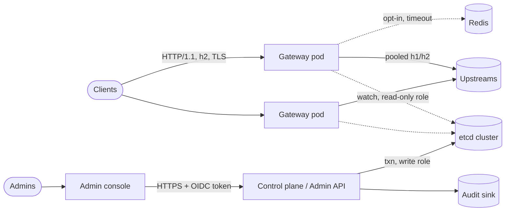
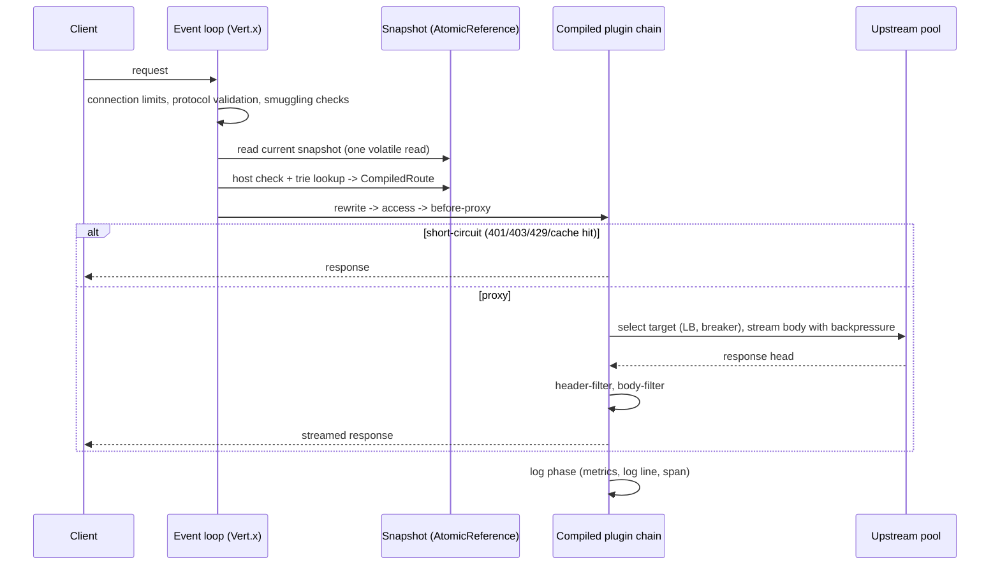

# Architecture overview

## Deployables

| Deployable | Form | Talks to |
|---|---|---|
| Gateway (data plane) | Native binary, Linux container | Clients, upstreams, etcd (read-only role, watch), Redis (optional) |
| Control plane (Admin API) | Native preferred, JVM fallback | etcd (write role), OIDC provider (JWKS), audit sink |
| Admin console | Static assets served by a minimal non-root static server | Admin API only, over HTTPS |
| etcd | 3-node cluster, TLS + auth | — |
| Redis | Optional | Gateway only (global rate limits, L2 cache) |



## Modules

| Module | Responsibility | Depends on |
|---|---|---|
| `config-model` | Config records (routes, services, upstreams, consumers, credentials, plugin configs, policies, certificates), value envelope, JSON Schemas for every plugin | Jackson |
| `gateway-core` | Immutable `Snapshot`, compiled radix route trie, plugin SPI (`Plugin`, `PluginFactory`, `Phase`), static `PluginRegistry`, request pipeline | `config-model`, Vert.x core |
| `gateway-plugins` | Built-in plugins: JWT/OIDC, API key, HMAC, authz, rate limit, cache, CORS, transforms, IP rules | `gateway-core` |
| `gateway-proxy` | Upstream pools, load balancers, health checks, circuit breaker, retries + budget, streaming proxy, SSRF connect-time check | `gateway-core` |
| `gateway-config` | etcd client wrapper, config worker, snapshot compiler, LKG store, node heartbeat | `gateway-core`, `config-model` |
| `gateway-observability` | Metrics registry, JSON logging setup, OTel tracing | Micrometer, OTel |
| `gateway-app` | `main`, constructor wiring, server bootstrap, Native Image metadata | all gateway modules |
| `control-plane` | Admin API, authn/authz, validation, change sets, publish/rollback, migrations, audit | `config-model` |
| `admin-console` | React + TS console (pnpm, not Gradle) | Admin API |
| `test-support` | Test-only PKI and etcd Testcontainers fixtures | BouncyCastle, Testcontainers |
| `integration-tests` | Testcontainers suites against the gateway process (JVM and native binary) | all |
| `benchmarks` | JMH microbenchmarks | `gateway-core`, `gateway-plugins`, `gateway-proxy` |

## Request flow



A request captures the snapshot once at the start and uses it to the end, so a config swap mid-request
is invisible to it.

## Config publish-to-apply

```mermaid
sequenceDiagram
  participant A as Admin (console)
  participant CP as Control plane
  participant E as etcd
  participant W as Config worker (each gateway)
  participant G as Gateway event loops
  A->>CP: POST /changesets/{id}/publish (If-Match)
  CP->>CP: validate against shared schemas, referential integrity, size + op-count limits
  CP->>E: Txn(compare mod_revision of every touched key; puts/deletes; history entry)
  E-->>CP: succeeded @ revision R
  E-->>W: watch events (R)
  W->>W: debounce (100 ms), apply to working copy, validate, compile
  W->>G: AtomicReference.set(newSnapshot)
  W->>W: persist LKG (R) to disk
  W->>E: update leased nodes/{gatewayId} = {appliedRevision: R, status}
  CP->>E: GET /gateways reads node keys
```

## Thread ownership

| Component | Thread(s) | Rule |
|---|---|---|
| HTTP server, routing, plugin chain, proxy | Vert.x event loops, one per core | Never blocks. No etcd calls |
| Upstream connections | Same event loop as the inbound request | Pool per event loop per target, no cross-thread hand-off |
| Config worker (watch, debounce, compile, LKG write) | One dedicated worker context (Vert.x worker or single platform thread) | Compiles off the event loop; publishes with one atomic swap |
| LKG disk I/O | Config worker thread | Never on an event loop |
| Node heartbeat (lease keepalive) | etcd client's own async threads | Async |
| JWKS / OIDC discovery refresh | Vert.x WebClient (async), timer on a worker context | Refreshed off the hot path; unknown-`kid` refresh rate limited |
| Active health checks | Vert.x timers + async client | Results published as immutable state |
| Redis client | Async (Vert.x Redis client) | Timeout + fail-open/closed on every call |
| Logging | Caller renders; one `gw-log-writer` daemon drains a bounded queue | Drops (and counts) instead of blocking when full |
| Control plane handlers | Virtual threads after native verification, otherwise a bounded worker pool | Not latency-critical |

## Key design choices

- **Snapshot.** An immutable object graph: route trie, compiled routes (per-route plugin chain arrays per
  phase), upstream definitions, consumer and credential indexes, policy indexes. Built from the whole
  key space at one etcd revision, validated, compiled, then published with one `AtomicReference.set`.
  A long-lived holder (upstream pools, breaker state) is keyed by stable ID, so a swap does not reset
  traffic state unless the upstream's definition changed.
- **Plugins.** Each plugin is a factory that turns validated JSON config into an immutable instance at
  compile time. Precedence: consumer > route > service > global. A route with no enabled plugin for a
  phase gets an empty array for it, so a disabled feature costs nothing per request.
- **Routing.** A host table (exact, then wildcard suffix) leads to per-host radix trees over path
  segments (static > param > prefix/catch-all), then a priority-ordered predicate list per leaf
  (method bitmask, header, query).
- **Errors.** Public errors are generic RFC 9457-shaped bodies with a request ID and no upstream detail.

## Roadmap

See spec §12 and `PROGRESS.md`. Order: M0 docs, M1 build + server + native + etcd spike, M2 core +
proxy, M3 config worker, M4 security plugins, M5 traffic plugins, M6 control plane, M7 console,
M8 observability, M9 deployment, M10 benchmarks.

## ADRs

| ADR | Title | Status |
|---|---|---|
| [0001](../adr/0001-record-architecture-decisions.md) | Record architecture decisions | Accepted |
| [0002](../adr/0002-module-layout.md) | Module layout | Accepted |
| [0003](../adr/0003-vertx-networking-core.md) | Vert.x 5 as the networking core | Accepted |
| [0004](../adr/0004-no-spring-boot.md) | No Spring Boot | Accepted |
| [0005](../adr/0005-json-library.md) | JSON with Jackson | Accepted |
| [0006](../adr/0006-metrics-and-tracing.md) | Micrometer/Prometheus metrics, OpenTelemetry tracing | Accepted |
| [0007](../adr/0007-logging-backend.md) | Logging backend: own SLF4J JSON provider | Accepted |
| [0008](../adr/0008-native-gc.md) | Native Image GC | Proposed (measured in M10) |
| [0009](../adr/0009-etcd-client.md) | etcd client: v3 HTTP/JSON gateway over Vert.x | Accepted |
| [0010](../adr/0010-dependency-vulnerability-scan.md) | Dependency scan via OSV | Accepted |
